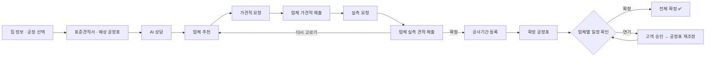
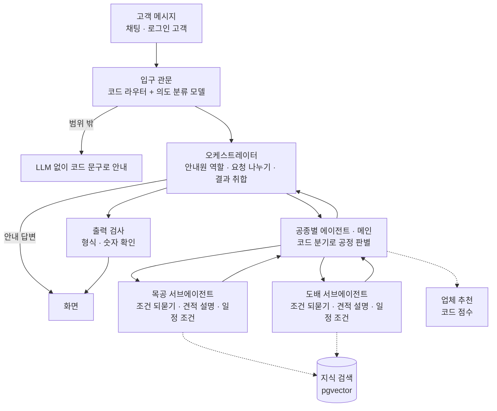
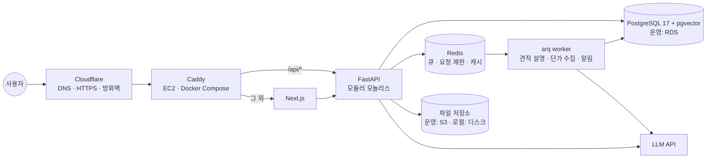

# 🏠 믿집 (MitJip)

> **반셀프 인테리어를 위한 표준견적, 공정 관리 서비스**
> 공공 기준으로 계산한 **표준견적서**와 업체 **가견적·실측 견적**을 같은 양식으로 비교하고, 계약 뒤에는 **공정표와 업체 일정**까지 한 곳에서 관리하는 AI 에이전트 서비스

SK Networks Family AI Camp 34기 · FINAL 1팀

<!-- TODO: 메인 화면 스크린샷 또는 시연 GIF -->
<!--  -->

---

## 📌 목차

1. [팀 소개](#-팀-소개)
2. [프로젝트 개요](#-프로젝트-개요)
3. [경쟁 서비스와 차별점](#-경쟁-서비스와-차별점)
4. [주요 기능](#-주요-기능)
5. [서비스 흐름](#-서비스-흐름)
6. [AI 에이전트 구조](#-ai-에이전트-구조)
7. [표준견적서 데이터](#-표준견적서-데이터)
8. [시스템 아키텍처](#-시스템-아키텍처)
9. [기술 스택](#-기술-스택)
10. [프로젝트 구조](#-프로젝트-구조)
11. [실행 방법](#-실행-방법)
12. [개발 규칙](#-개발-규칙)
13. [평가](#-평가)
14. [개발 일정](#-개발-일정)
15. [향후 계획](#-향후-계획)
16. [회고](#-회고)

---

## 👥 팀 소개

| 이름 | 담당 | GitHub |
| :---: | --- | :---: |
| 이성민 | 인프라 · MVP 흐름 UI/UX | [@lsm15111](https://github.com/lsm15111) |
| 이현준 | 백엔드 · 데이터 수집 | [@gksrkd2](https://github.com/gksrkd2) |
| 임형준 | 산출물 · LLM · 에이전트 | [@HyeongJjun](https://github.com/HyeongJjun) |
| 전진환 | ML · DL · 데이터 수집 | [@dfs32dfs](https://github.com/dfs32dfs) |
| 채정석 | 기획 · 데이터 수집 · 프론트엔드 | [@qnfdhk-rgb](https://github.com/qnfdhk-rgb) |

---

## 💡 프로젝트 개요

### 시장 배경: 고쳐 쓸 집이 늘고, 시장도 커짐

| 지표 | 내용 |
| --- | --- |
| 준공 20년 이상 주택 | 전국 주택 중 비율이 2021년 처음 **50%** 를 넘음 |
| 리모델링 시장 | 2020년 30조 원 → 2030년 **44조 원** 전망 |
| 집 사는 데 드는 목돈 | 수도권 집값은 한 해 소득의 **8.7배**, 생애 첫 집 마련까지 **7.9년** |
| 산 집은 점점 구축 | 서울 아파트 매매 중 준공 30년 넘은 집 **20.3% → 23.8%** |

> 목돈을 쓴 뒤라 인테리어는 아끼고 싶고, 낡은 집을 사서 고칠 곳은 많음 → **반셀프 인테리어 수요**

<sub>출처: 한국건설산업연구원 보도자료(2020), 건산연 2020.12, 통계청(SBS Biz), 국가데이터처 2025 인구주택총조사(뉴시스 2026.07), 국토교통부 2024년도 주거실태조사(뉴시스 2025.11.16), 국토교통부 실거래가 분석(MTN 2026.04.21)</sub>

### 인테리어 방식 3가지

믿집은 가운데 **반셀프**를 돕는 서비스입니다.

| | 턴키 | **반셀프 (믿집 대상)** | 셀프 |
| --- | --- | --- | --- |
| 방식 | 업체 1곳이 설계부터 마감까지 | 공정별 업체를 내가 골라 연결 | 시공까지 내가 직접 |
| 업체가 맡는 범위 | 업체가 전부 | 공정별 업체, 조율은 나 | 내가 전부 |
| 비용 | 높음 | 중간 | 낮음 |
| 어려움 | 편하지만 총액 견적이라 내역이 잘 안 보임 | 견적 비교 · 업체 검증 · 일정 조율이 전부 내 몫 | 기술 · 시간이 들고 하자도 내 책임 |

### 문제 정의: 반셀프 6단계, 단계마다 막힘

| 단계 | 막히는 점 | 근거 | 믿집 화면 |
| --- | --- | --- | --- |
| 1. 정보 수집 | 무엇부터, 어떤 서류부터 할지 모름 | 반셀프 컨설팅이 **시간당 10만 원**에 거래됨 (숨고), 동의서 · 행위허가도 소비자가 직접 (서울신문 2026.07) | 안내 |
| 2. 공정표 짜기 | 공정 순서를 모름, 목공 전에 도배하면 재시공 | 목공(몰딩, 걸레받이)이 끝나야 도배로 넘어갈 수 있음 | 예상 공정표 |
| 3. 가견적 | 업체마다 견적이 제각각, 적정 금액 기준이 없음 | 같은 집인데 업체 견적 2,500만 vs 4,000만 원, **1.6배** 차이 (비즈한국) | 표준견적서 |
| 4. 실측, 실견적 | 업체마다 양식이 달라 비교가 어렵고, 실측 뒤 금액이 바뀌어도 따질 근거가 없음 | | 견적 비교 · 설명 |
| 5. 업체 선정 | 검증 수단은 후기뿐 | 인테리어 업체 **70~80%** 가 실내건축공사업 면허 없음 (서울신문 2026.04.01) | 업체 고르기 |
| 6. 공사 진행 | 여러 업체 일정을 직접 조율, 한 공정이 밀리면 뒤도 밀림 | "다시 하라면 힘들어서 못 하겠다" (반셀프 경험자, 비즈한국) | 확정 공정표 |

### 서비스 대상

- **고객**: 아파트 반셀프 인테리어를 준비하는 소비자
- **업체**: 사업자등록증으로 가입하고 관리자 승인을 받은 공정별 시공 업체

### 1차 범위 (MVP): 아파트 도배 · 목공

```
철거 → 설비·전기 → [목공] → 타일 → 도장 → [도배] → 바닥 → 가구·조명
                    1차 범위               1차 범위
```

| 왜 두 공정부터인가 | |
| --- | --- |
| 가장 기본이 되는 공정 | 집 고치기에 거의 빠지지 않아 먼저 검증하기 좋음 |
| 공공 데이터로 검증 가능 | 일위대가에 도배 · 몰딩 단가가 있음 |
| 순서가 틀리면 재시공 | 목공 전에 도배하면 다시 해야 함 → 공정표의 가치가 분명함 |

범위 밖(바닥 · 욕실 · 전기, 전자계약, 결제)은 [향후 계획](#-향후-계획)으로 관리합니다.

---

## 🆚 경쟁 서비스와 차별점

보증 · 현장 관리 · 정해진 가격은 있지만, 반셀프 소비자가 직접 하는 일은 남아 있습니다.

| | 오늘의집 | 집닥 | 아파트멘터리 | 숨고 | 반셀인 | **믿집** |
| --- | :---: | :---: | :---: | :---: | :---: | :---: |
| **기준 가격** | △ 상담 뒤 업체 견적 | × | △ 자기 회사 가격표 | × | × | **○ 공공 기준으로 계산** |
| **견적 비교** | × | × | × | △ 여러 업체 견적 | △ 업체와 직접 연결 | **○ 같은 양식으로 비교** |
| **일정 관리** | △ 늦어지면 보상 | △ 담당자가 현장 점검 | △ 자기 회사가 시공 | × | × | **○ 공정표로 일정 관리** |

<sub>○ 있음 · △ 일부 · × 없음 / 출처: 바이라인네트워크 2023.06.23(오늘의집), 오늘의집 파트너 표준견적서 작성 가이드, 인사이트(집닥), 벤처스퀘어(아파트멘터리), App Store(숨고, 반셀인)</sub>

### 차별점 1. 표준견적서: 상담 전에 보는 공정한 비교 기준

경쟁 서비스의 기준 가격은 상담 뒤 · 자기 회사 기준이지만, 믿집은 **상담 전 · 공공 기준**입니다. 공공 기준 단가 × 우리 집 면적으로 계산하고, 줄마다 공공 출처를 붙입니다. **같은 조건이면 언제나 같은 금액**이 나옵니다.

| 항목 | 출처 |
| --- | --- |
| 인건비 | 2026 상반기 표준일위대가 (실내건축) |
| 자재비 | 조달청 가격 + 시중 가격 (수집 예정) |
| 간접비 | 법령 · 고시 요율 |
| 물량 | 우리 집 정보 (평형, 바탕면, 길이) |

### 차별점 2. 공정별 AI 상담: 같은 조건 · 같은 칸으로 비교

경쟁 서비스는 견적을 모아 주기만 해서 조건 · 양식이 다르면 고객이 직접 맞대야 합니다. 믿집은 견적에 필요한 조건을 에이전트가 대신 물어 **같은 조건**으로 맞추고, 실측 견적서는 **같은 칸**으로 받습니다.

1. **모르는 조건은 대신 물어봄** — 기존 벽지를 뜯을지 · 덧바를지처럼 견적에 필요한 것
2. **모르면 '실측 후'로 남김** — 억지로 정하지 않고 실측 때 업체가 확인
3. **정리한 조건은 표준견적서로** — 수량 계산에 그대로 쓰임

### 차별점 3. 공정표: 반셀프도 일정 관리를 받음

경쟁 서비스는 업체에 통째로 맡길 때만 일정을 관리해 줍니다. 믿집은 목공 → 도배 순서를 계산한 **반셀프 공정표**를 만들고, 업체가 확정 또는 연기로 회신하면 **연기는 고객 승인 뒤 재조정**합니다. 예상 공정표는 반나절 단위로 계산해 하루 단위로 보여 줍니다.

| 근거 | 데이터 |
| --- | --- |
| 작업 기간 | 물량 × 품 (표준일위대가) |
| 공정 순서 | 표준시방서 선후 규칙 |
| 공휴일 | 공공데이터 특일 정보 |
| 공사 가능 시간 | 공동주택 관리규약 |

---

## ✨ 주요 기능

| 구분 | 기능 | 설명 |
| --- | --- | --- |
| 고객 | 프로젝트 시작 | 집 정보 입력, 공정 선택 |
| 고객 | 표준견적서 · 예상 공정표 | 공공 기준 단가로 계산한 참고 금액과 예상 일정 |
| 고객 | AI 상담 | 오케스트레이터가 시작 순서 · 서류를 안내하고, 공정별 서브에이전트가 조건을 묻고 주의점을 안내 |
| 고객 | 업체 추천 | 조건 필터 + 점수로 3곳 추천, 추천 사유 제공 |
| 고객 | 견적 비교 | 표준견적서 ↔ 가견적 ↔ 실측 견적 항목별 비교와 AI 설명 |
| 고객 | 공정표 관리 | 확정 공정표, 업체 연기 요청 승인, 자동 재조정 |
| 업체 | 가견적 · 실측 견적 제출 | 표준 행 양식으로 작성 |
| 업체 | 일정 관리 | 공사기간 등록, 일정 확정 또는 연기 요청 |
| 관리자 | 업체 승인 · 회원 관리 | 사업자등록증 확인 후 업체 기능 승인 |

<!-- TODO: 기능별 스크린샷 -->

---

## 🔄 서비스 흐름



---

## 🤖 AI 에이전트 구조

**"질문은 안내원이 받고, 공정 질문은 전문가에게"** — 금액 계산, 공정표 생성, 업체 추천은 코드와 계산 엔진이 맡고, 에이전트는 대화 · 설명 · 조건 정리를 맡습니다.



| 구성 | 역할 |
| --- | --- |
| **입구 관문** | 코드 라우터 + 의도 분류 모델. 범위 밖 요청은 LLM 없이 안내 |
| **오케스트레이터** | 처음 고객의 시작 순서 · 서류(동의서, 행위허가)를 단계로 안내하고 버튼으로 표준견적서 · 공정표 화면에 연결. 금액은 말하지 않고 계산한 화면으로 안내. 공정 요청은 공종별 에이전트로 넘기고, 돌아온 답을 목공 → 도배 순서로 정리해 질문을 한 카드로 묶음 |
| **공종별 에이전트 (메인)** | 코드 분기로 공정을 골라 서브에이전트에 분배, 모르면 되물음. 프로젝트 정보는 코드가 먼저 읽어 넘김 |
| **목공 · 도배 서브에이전트** | 공정별 상담 · 견적 설명 · 일정 조건. 금액 · 날짜는 넣지 않고, 물을 것과 주의점을 정해진 형식으로 답함 |
| **출력 검사** | 형식과 숫자 확인. 숫자가 저장된 값과 다르면 그 문장은 내보내지 않음 |

### 서브에이전트가 하는 일

| 할 일 | 언제 | 목공 | 도배 | 지키는 것 |
| --- | --- | --- | --- | --- |
| 상담 | 공정을 고른 뒤 채팅 | 몰딩, 걸레받이 길이, 문틀 교체 | 바탕면, 기존 벽지 철거, 도배 유형 | 모르면 '실측 후'로 남김 |
| 견적 설명 | 견적서 안 질문 버튼, 견적 도착 뒤 | 정목수 · 부목수 품 차이 | 자재 줄이 '따로 계산'인 이유 | 금액은 저장된 값만 |
| 일정 조건 | 공정표 계산 전 | 작업 일수, 자재 반입 | 목공 뒤 시공, 건조 시간 | 날짜는 계산 엔진만 |

### 오케스트레이션 예시

```
고객 → 입구 관문 → 오케스트레이터 → 공종별 에이전트
  → 목공 서브에이전트  할 일: 거실 몰딩 교체 조건 정리 (32평, 준공 2008년)
       ↳ 물을 것: 천장 몰딩 길이, 걸레받이 교체 여부 / 주의: 몰딩이 끝나야 도배 가능
  → 도배 서브에이전트  할 일: 거실 도배 조건 정리 (같은 프로젝트 정보)
       ↳ 물을 것: 기존 벽지 철거 여부, 도배 유형 / 주의: 목공 끝난 뒤 시공, 바탕면 확인
→ 오케스트레이터가 목공 → 도배 순서를 확인하고 질문을 한 카드로 묶어 고객에게
```

- 서브에이전트 추가 = 설정 하나 추가 = 공정 하나 추가
- 할 일마다 평가 세트를 두고, 호출은 에이전트별 도구 4회 · 턴당 하위 호출 3회로 제한합니다.
- 의도 분류 신뢰도가 낮으면 보조 모델로 한 번 더 판단하고, 그래도 낮으면 고객에게 되묻습니다.
- 지식 검색은 PostgreSQL **pgvector** 기반 RAG를 사용합니다.
- 일정 기능은 **MCP 서버**(`mcp_server.py`)로도 제공합니다.

---

## 🗂 표준견적서 데이터

### 데이터가 어려웠던 이유

공공데이터는 허가 · 신고에서 쌓이는데, 인테리어는 대부분 신고하지 않습니다.

- **건축**: 공사 → 허가 · 신고 → 건축물대장 → 공공데이터로 통계가 쌓임
- **인테리어**: 도배 · 목공 · 욕실 공사 → 구조를 바꿀 때만 신고 → 가격 · 날짜 기록이 남지 않음

| 그 밖의 이유 | 내용 |
| --- | --- |
| 작은 공사 | 1,500만 원 미만은 건설업 등록 없이 시공 가능 → 통계 밖 공사가 많음 (건설산업기본법 시행령 제8조) |
| 가격 자료 | 관공서 공사 단가는 있지만 인테리어 거래가는 공개된 가격표가 없음 |
| 제각각인 견적 | 자재 · 디자인 · 현장 상태 · 견적 방식이 달라 같은 기준이 없음 |
| 바꾸는 주기 | 10~15년마다 바꾸는 소모성 공사라 나라가 기록하지 않음 |
| 담당 기관 | 국토부 · 산업부 · 공정위 · 소비자원으로 나뉘어 모아 정리할 곳이 없음 |

### 해결 방법: 공공 기준으로 직접 만들고, 부족한 부분은 서비스 데이터로

| 단계 | 견적서 | 공정표 |
| --- | --- | --- |
| **1차** 공공 기준으로 시작 | 표준품셈 + 건축 일위대가 (도배 벽 1㎡ 노무비 6,656원) | 건축공사 표준시방서 |
| **2차** 실내건축 자료로 보충 | 실내건축 일위대가 | LH 전문시방서 |
| **3차 · 예정** 서비스 데이터로 고침 | 업체 단가 · 실측 견적 금액 | 실제 공사 날짜 · 연기 기록 |

- **자재비**: 1차(예정)는 조달청 가격으로 공공 기준 → 3차는 업체 견적에 적힌 자재 단가로 시중 가격 보정
- 서비스 데이터는 개인정보를 빼고 모아 정제합니다.

| 수집 예시 | 내용 |
| --- | --- |
| 표준품셈 | 하루 95㎡ = 도배공 2 + 보통인부 1 |
| 실내건축 일위대가 | 도배바름 1㎡ → 6,672원 |
| 물량 · 평면도 | 벽 도배 면적 59㎡ 126.97㎡ · 84㎡ 180.09㎡ (AI Hub 도면 기반 물량 산출서, 팀 작성) |
| 표준시방서 | 도배 공정 순서 → 공정표 단계 |
| LH 시방서 | 72시간 전 ~ 48시간 후 5℃ 이상 → 건조 기간 |

<sub>자료: 2026 건설공사 표준품셈(× 2026.9.1 노임), 2026 실내건축 일위대가, 건축공사 표준시방서(KCS 41 51 05 등), LH 전문시방서(LHCS 41 51 05 등)</sub>

### 전처리 흐름

원본 12개는 그대로 두고, 검색 · 비교 · 검증이 되는 CSV 12개로 구조화했습니다.

```
01 원본 수집 → 02 원본 확인 → 03 데이터 추출 → 04 데이터 분류
(PDF·Excel 12개)  (해시·페이지·시트·출처)  (PDF 본문·표, Excel 셀·수식)  (RAG용 8개, 정형 4개)
→ 05 표준화 → 06 CSV 생성 → 07 검증 → 08 메타데이터
(수치·단위 통일, 원본 값 보존)  (CSV 12개)  (누락·중복·수치 변형)  (불명확 값 표시, 계산 가능 여부)
```

| 최종 산출물 | |
| --- | --- |
| 결과 | CSV 12개 · 레코드 **55,593개** (RAG 8 + 정형 4) |
| 원본 추적 | 해시 · 페이지 · 셀 위치 |
| 활용 | PostgreSQL · pgvector에 적재해 표준견적 · 공정표에 사용 |

- 원본을 바꾸지 않고 구조화
- 정확한 조회 · 계산은 정형 데이터, 시공 기준 · 규정 검색은 RAG
- 불명확한 값은 임의 보정 없이 검토 대상으로 표시
- 과거 법령 · 불명확 규정은 자동 계산에서 제외

---

## 🏗 시스템 아키텍처

<!-- TODO: 아키텍처 이미지로 교체 가능 -->

운영(스테이징)은 **EC2 한 대에 Docker Compose**, 데이터는 **RDS**, 파일은 **S3**에 둡니다. 로컬은 `compose.yaml`로 DB까지 컨테이너로 띄웁니다.



| 구성 | 역할 |
| --- | --- |
| `frontend/` (Next.js) | 화면만 담당. DB 접근 · LLM 호출 · 금액 계산 없음 |
| `backend/app/` (FastAPI) | 유일한 공개 API. 기능 패키지 + 계산 엔진 `calc` + 에이전트 `agent` |
| `worker.py` (arq) | 대화 밖의 느린 작업 (LLM 설명, 기준 단가 수집, 알림) |
| PostgreSQL + pgvector | 원본 데이터와 지식 검색. 운영은 RDS |
| Redis | 큐 · 요청 제한 · 짧은 캐시 (지워져도 되는 데이터만) |
| S3 | 운영 파일 저장소 (사업자등록증 · 사진 등) |

---

## 🛠 기술 스택

| 분야 | 기술 |
| --- | --- |
| **Frontend** |    |
| **Backend** |     |
| **AI** | <!-- LLM 공급자 / 프레임워크 확정 후 기입 -->   |
| **Database** |   |
| **Infra** |       |
| **CI/CD** |  |

---

## 📂 프로젝트 구조

```
SKN34-FINAL-1TEAM/
├── frontend/                # Next.js 웹
│   ├── app/                 # 화면(라우트): start · projects/[id](standard · plan · vendors · request · quotes · measure · schedule · history) · my · vendor · admin
│   ├── components/          # 화면 조각 (site · start · project · vendors · my · auth · admin · chat)
│   └── lib/                 # 세션 · API 호출 · 표시 형식
├── backend/                 # FastAPI API
│   ├── app/
│   │   ├── agent/           # 오케스트레이터 · 공종별 에이전트 · 목공/도배 서브에이전트
│   │   ├── calc/            # 표준견적 · 견적 차이 · 업체 점수 · 공정표 계산 엔진
│   │   ├── knowledge/       # RAG 지식 적재 · 검색
│   │   ├── chat/            # 대화 (SSE · 에이전트 도구)
│   │   ├── project/ vendor/ auth/ account/ files/ shared/
│   │   ├── mcp_server.py    # 믿집 일정 MCP 서버
│   │   └── worker.py        # arq worker
│   ├── migrations/          # Alembic
│   └── tests/
├── evaluation/              # 에이전트별 eval (intent · orchestrator · guide · consult · quote_explanation · schedule · rag)
├── deploy/aws/              # 스테이징 배포 (compose · Caddyfile)
├── infra/aws/               # 인프라 정의
├── compose.yaml
├── AGENTS.md                # 사람과 AI 코딩 도구가 함께 지키는 작업 규칙
└── CONTRIBUTING.md          # 팀 작업 방법
```

---

## 🚀 실행 방법

### 사전 준비

- Docker / Docker Compose

### 실행

```bash
cp .env.example .env   # SEED_PASSWORD에 시험 계정 비밀번호(8자 이상)를 넣는다
docker compose up -d --build
docker compose watch web   # 화면 코드를 고치면 바로 반영한다 (이 창은 켜 둔다)
```

- 웹 http://localhost:3000 · API 문서 http://localhost:8000/docs
- 화면(web)은 폴더를 연결하지 않고, `docker compose watch`가 바뀐 파일만 컨테이너로 복사해요. 고치면 1초 안팎에 반영돼요(Turbopack). watch 없이 `up`만 하면 이미지를 만든 때의 화면 코드로 떠요.
- 컨테이너에서 만든 파일은 PC로 돌아오지 않아요. `pnpm gen:api`처럼 파일을 만드는 명령은 PC의 `frontend`에서 돌립니다.
- 화면을 더 빨리 고치려면 웹만 PC에서 띄워요: `docker compose stop web` 뒤 `cd frontend && pnpm dev --port 3100` (http://localhost:3100)
- `port is already allocated` 오류가 나면 그 포트를 이미 다른 프로그램이 쓰는 거예요. `.env`의 `*_HOST_PORT`를 바꾸고 다시 실행합니다.
- 시험 계정(로컬 전용, 자동 생성): `admin@` · `customer@` · `vendor@` · `vendor-pending@mitjip.local`, 비밀번호는 `.env`의 `SEED_PASSWORD`. 다시 만들 때 `docker compose exec api python -m app.seed`
- 실제 관리자 계정: `docker compose exec api python -m app.auth.cli create-admin --email <메일> --name 관리자`

---

## 🤝 개발 규칙

1. 작업 이슈를 만들고, 개인 fork의 최신 `dev`에서 작업 브랜치를 만듭니다.
2. 이슈를 연결한 PR을 팀 `dev`로 올리고 CI와 리뷰를 통과하면 squash 병합합니다.
3. 로컬·CI에서 통합 검증 후 공식 저장소 `dev` → `main` PR을 만들고 merge commit으로 병합합니다.
4. `main`의 Push CI가 성공하면 해당 main 커밋을 AWS에 자동배포하고 서버 상태를 확인합니다.

`dev` 병합만으로 AWS에 배포되지는 않습니다. 기본 브랜치 목표는 `dev`이며, 실제 설정과 기존 CD를 바꾸는 순서는 [개발 흐름 전환 절차](docs/development-flow.md)에 있습니다. 별도 운영 환경(`prod`)은 아직 없습니다.

작업 규칙은 [AGENTS.md](AGENTS.md), 팀 작업 방법은 [CONTRIBUTING.md](CONTRIBUTING.md)에 있습니다.

---

## 📊 평가

`evaluation/`에 에이전트별 eval 세트를 두고 dev와 held-out을 2:1로 나눕니다. CI에서는 유료 LLM 호출 없이 스텁(`LLM_LIVE=false`)으로만 돌립니다.

| eval 세트 | 개수 |
| --- | ---: |
| 의도 분류 (`intent`) | 200 |
| 가이드 (`guide`) | 50 |
| RAG (`rag`) | 30 |
| 오케스트레이터 (`orchestrator`) | 30 |
| 공정표 (`schedule`) | 15 |
| 상담 (`consult`) | 10 |
| 견적 설명 (`quote_explanation`) | 문제 행 시나리오 |

<!-- TODO: evaluation/run.py 실행 방법 기입 (아직 비어 있음) -->

| 대상 | 지표 | 결과 |
| --- | --- | --- |
| 의도 분류 | Accuracy / F1 | <!-- TODO --> |
| RAG 검색 | Recall@k | <!-- TODO --> |
| 견적 설명 | 정확성 · 근거 일치 | <!-- TODO --> |
| 공정표 | 제약 위반 수 | <!-- TODO --> |

---

## 📅 개발 일정

11/27까지 기능을 완료하고, 마지막 주는 시연과 테스트에 씁니다.

| 기간 | 단계 | 할 일 |
| --- | --- | --- |
| ~ 11/13 | 계산, 데이터 | 표준견적 계산 · 화면, 문서 적재 · RAG 평가, 의도 분류 모델, 업체 시드 8~10곳 |
| ~ 11/20 | 에이전트 1차 | 일정 MCP, 공정표 계산, 목공 서브에이전트 · 안내, 채팅 화면(SSE) |
| ~ 11/27 | 기능 완료 | 오케스트레이터, 도배 설정, 견적 설명, 업체 추천 |
| ~ 12/4 | 시연 준비 | 일정 회신 · 알림, 멀티 에이전트 평가, 서비스 테스트 |
| 12/8 | 최종 발표 | 시연, 평가 결과, 확장 계획 |

---

## 🗺 향후 계획

지금은 2개 공정, 목표는 **같은 구조로 전 공정을 에이전트로** 관리하는 것입니다.

### 기능 고도화

- [ ] **도면 → 수량 자동 산출**: 평면도에서 벽 · 면적을 추출해 가견적을 실측에 가깝게. "거실 벽 면적은?"처럼 물어 수량을 뽑아 표준견적서에 연결 (참고: 「아파트 평면도 해석을 위한 Visual Question Answering 활용」, 서강대 일반대학원 학위논문)
- [ ] **스케줄러 에이전트**: 확정 전 업체 일정을 고객 대신 조율
- [ ] **공정 확장**: 바닥 · 욕실 · 전기
- [ ] **금액 변동 예측**: 실측 사례로 가견적 → 실측 견적 변동 예측
- [ ] 전자계약 · 결제(에스크로) 연동
- [ ] 공사 진행 사진 기록 · 진행률 확인
- [ ] 하자 증빙 관리
- [ ] 셀프 인테리어 고객용 자재 발주서

### 수익 모델

데이터가 쌓이는 순서대로 수익원을 늘립니다.

| 단계 | 모델 | 내용 | 수익원 |
| --- | --- | --- | --- |
| 1단계 · 지금 (MVP) | 업체 등록 수수료 | 고객 무료, 업체 등록 수수료. 사용자 · 견적 데이터를 쌓음 | 업체 등록비 |
| 2단계 · 고도화 | 견적 검토비 + 업체 광고 | 견적 설명 정확도를 검증한 뒤 고객 견적 검토비(B2C), 업체 광고비(B2B) | + 견적 검토비, 업체 광고비 |
| 3단계 · 커뮤니티 | 후기 커뮤니티 광고 | 확정된 거래만 후기 작성 → 믿을 수 있는 후기. 후기가 쌓여야 광고가 붙음 | + 커뮤니티 광고 |
| 4단계 · 확장 | 에스크로 결제 수수료 | 공사 대금을 믿집에 맡기고 공정마다 업체에 지급. PG사 에스크로 제휴로 시작 | + 에스크로 수수료 |

> **원칙**: 광고는 '광고'로 표시하고, 견적 설명 결과와 업체 추천 순서에는 반영하지 않습니다.

---

## 📝 회고

<!-- TODO: 최종 발표 뒤 작성 -->


## 기준 데이터·RAG 스키마 적용

로컬 DB는 PostgreSQL 17 Alpine에 pgvector 0.8.7을 더한 이미지를 사용합니다. 기존 볼륨은 유지합니다.

```bash
docker compose build db
docker compose up -d --no-deps db
docker compose run --rm --no-deps migrate uv run --locked alembic upgrade head
```

위 migration 명령은 기본 시드 명령을 덮어씁니다. 새 revision은 vector 확장과 빈 테이블 7개만 만들며 CSV 적재·임베딩 생성은 하지 않습니다. Python 의존성이 바뀌었으므로 이후 API/worker 이미지를 갱신할 때는 새 lock 파일로 빌드합니다.

현재 0019의 downgrade는 새 표를 제거하므로 데이터 적재 뒤에는 별도 보존 판단이 필요합니다. 공유 vector 확장은 downgrade에서 제거하지 않습니다. AWS RDS 적용 전에는 해당 PostgreSQL 버전의 vector 확장 제공 여부와 migration 계정 권한을 확인합니다.
